# 🏛️ System Architecture: ActionGate
## Technical Blueprint & Cryptographic Authorization Pipeline
**Hackathon:** VORTEXA 3.0 (12-Hour National Student Hackathon)  
**Host Institution:** AIRS, Dr. D. Y. Patil Institute of Technology, Pimpri, Pune  
**Domain:** Domain 1 — Cybersecurity & Digital Trust  
**Problem Statement Code:** C-01 — ActionGate  
**File Reference:** `architechture.md`  

---

## 1. Architectural Philosophy & Design Principles

ActionGate is built upon four foundational software engineering and cybersecurity tenets:

1. **Zero-Trust by Default (Least Privilege & Explicit Identity):** No agent or tool is trusted implicitly. Absence of registration equates to immediate denial.
2. **Deterministic Supremacy:** While Large Language Models provide rich semantic context, security policies with real-world consequences must follow rigid, deterministic, and verifiable mathematical rules. AI may escalate risk, but cannot bypass a deterministic block.
3. **Cryptographic Immutability & Anti-TOCTOU:** To combat Time-of-Check to Time-of-Use (TOCTOU) argument alterations, authorizations are bound to canonical SHA-256 payload digests rather than generic action references.
4. **Resilient Fail-Safe Operation:** The authorization layer must never act as a single point of failure. If external cognitive services (Gemini API) experience network degradation or rate limiting, ActionGate seamlessly falls back to local deterministic heuristic analysis with zero downtime.

---

## 2. High-Level System Architecture

The following diagram illustrates the topological structure of ActionGate, depicting the unbypassable gateway proxy situated between Autonomous AI Agents and Enterprise Execution Environments:

```
+---------------------------------------------------------------------------------------------------------+
|                                    AUTONOMOUS AI AGENT LAYER                                             |
|   (Financial Agents, Customer Support Bots, DevOps/Infrastructure Workers, Unregistered Rogue Agents)    |
+---------------------------------------------------------------------------------------------------------+
                                                     |
                         [Proposed Action Request: JSON Payload + Rationale]
                                                     v
+=========================================================================================================+
|                                  ACTIONGATE AUTHORIZATION PROXY (Node.js)                                |
|                                                                                                         |
|   +-------------------------------------------------------------------------------------------------+   |
|   | INTAKE GATEWAY & PARSER                                                                         |   |
|   | • Identity Verification (`KNOWN_AGENTS`)                                                        |   |
|   | • Action Catalog Whitelist Check (`ACTION_CATALOG`)                                             |   |
|   | • Canonical JSON Normalization & SHA-256 Payload Hash Generation                                |   |
|   +-------------------------------------------------------------------------------------------------+   |
|                                                     |                                                   |
|                        +----------------------------+----------------------------+                      |
|                        v                                                         v                      |
|   +------------------------------------------+              +---------------------------------------+   |
|   | LAYER 1: DETERMINISTIC POLICY ENGINE     |              | LAYER 2: SEMANTIC AI INTENT ANALYZER  |   |
|   |------------------------------------------|              |---------------------------------------|   |
|   | • Blast Radius Calculator (Record Count) |              | • External: Google Gemini 2.5 Flash   |   |
|   | • Financial Threshold Engine ($1,000 max)|              | • Internal: Safe Deterministic Fallback|   |
|   | • Operational Reversibility Check        |              | • Rationale vs. Arguments Alignment   |   |
|   | • Destructive Pattern & AST Regex Filter |              | • Semantic Risk Score (0 - 100)       |   |
|   +------------------------------------------+              +---------------------------------------+   |
|                        \                                                         /                      |
|                         \                                                       /                       |
|                          v                                                     v                        |
|   +-------------------------------------------------------------------------------------------------+   |
|   | LAYER 3: POLICY SYNTHESIS & ARBITRATION MATRIX                                                  |   |
|   | • Deterministic BLOCKED -> Final BLOCKED (Unconditional)                                         |   |
|   | • AI Risk >= 80 or Critical Tier -> Escalate to BLOCKED                                         |   |
|   | • Deterministic Threshold / Reversibility Trigger -> HELD_FOR_APPROVAL                          |   |
|   | • Semantic Intent Mismatch -> Escalate to HELD_FOR_APPROVAL                                      |   |
|   +-------------------------------------------------------------------------------------------------+   |
|                                                     |                                                   |
|             +---------------------------------------+---------------------------------------+           |
|             v                                       v                                       v           |
|      🟢 ALLOWED                            🟡 HELD FOR APPROVAL                        🔴 BLOCKED       |
|    (Auto-Authorized)                     (4-Eyes Isolated Queue)                 (Security Violation)   |
|             |                                       |                                       |           |
|             +---------------------------------------+---------------------------------------+           |
|                                                     |                                                   |
|                                                     v                                                   |
|   +-------------------------------------------------------------------------------------------------+   |
|   | LAYER 4: CRYPTOGRAPHIC AUDIT LEDGER (SHA-256 Hash Chained Blockchain)                           |   |
|   | • Block Construction: [Index, Timestamp, ActionID, AgentID, Hash, Verdict, Path, PrevHash]     |   |
|   | • In-Memory Linked Audit Chain (Tamper-Evident Non-Repudiation)                                 |   |
|   | • Real-Time Integrity Verification Engine (`/api/ledger/verify`)                                |   |
|   +-------------------------------------------------------------------------------------------------+   |
+=========================================================================================================+
                                                     |
                         [Execution Authorization OR Security Refusal]
                                                     v
+---------------------------------------------------------------------------------------------------------+
|                                    ENTERPRISE EXECUTION LAYER                                           |
|       (Stripe Financial APIs, Production PostgreSQL / MySQL, AWS / Cloud Run, SendGrid Mailers)         |
+---------------------------------------------------------------------------------------------------------+
```

---

## 3. End-to-End Execution Sequence Diagrams

### 3.1 Primary Action Ingestion & Decision Flow
This sequence illustrates how an agent proposal is ingested, evaluated across dual engines, arbitrated, and committed to the cryptographic ledger.

```mermaid
sequenceDiagram
    autonumber
    actor Agent as Autonomous AI Agent
    participant Gateway as ActionGate Controller (/api/actions/evaluate)
    participant DetEngine as Layer 1: Deterministic Policy Engine
    participant AIEngine as Layer 2: Semantic Intent Evaluator
    participant ApprovalStore as 4-Eyes Approval Store
    participant Ledger as Layer 4: Cryptographic SHA-256 Ledger
    actor Target as Enterprise Execution API

    Agent->>Gateway: POST /api/actions/evaluate {agentId, actionType, payload, rationale}
    Gateway->>Gateway: Compute Canonical SHA-256 Hash of Payload
    
    rect rgb(20, 25, 45)
        Note over Gateway, DetEngine: Layer 1 Evaluation (The Authority)
        Gateway->>DetEngine: evaluateDeterministicPolicy({agentId, actionType, payload})
        DetEngine->>DetEngine: Check Agent Directory & Action Catalog
        DetEngine->>DetEngine: Check Blast Radius & Financial Thresholds
        DetEngine->>DetEngine: Scan Destructive SQL/Shell Injections
        DetEngine-->>Gateway: policyResult (decision, impactLevel, isReversible)
    end

    rect rgb(35, 20, 45)
        Note over Gateway, AIEngine: Layer 2 Evaluation (The Informer)
        Gateway->>AIEngine: evaluateAiIntent({payload, rationale, simulateAiOffline})
        alt AI Online (Gemini 2.5 Flash)
            AIEngine->>AIEngine: Prompt Gemini Model for Semantic Analysis
            AIEngine-->>Gateway: aiResult (riskTier, riskScore, intentMatch, decisionPath="GEMINI_2_5_FLASH")
        else AI Offline / Error Fallback
            AIEngine->>AIEngine: Local Heuristic Fallback Analysis
            AIEngine-->>Gateway: aiResult (riskTier, riskScore, intentMatch, decisionPath="DETERMINISTIC_SAFE_FALLBACK")
        end
    end

    rect rgb(25, 40, 25)
        Note over Gateway: Layer 3 Synthesis Arbitration
        Gateway->>Gateway: Synthesize Final Verdict (ALLOWED | HELD | BLOCKED)
    end

    alt Verdict == ALLOWED
        Gateway->>Ledger: appendRecord(actionId, payloadHash, decision="ALLOWED")
        Gateway-->>Agent: 200 OK (ALLOWED, ledgerBlockIndex)
        Agent->>Target: Execute Tool Action
    else Verdict == HELD_FOR_APPROVAL
        Gateway->>ApprovalStore: createPending({actionId, payloadHash, impactLevel, ...})
        Gateway->>Ledger: appendRecord(actionId, payloadHash, decision="HELD_FOR_APPROVAL")
        Gateway-->>Agent: 200 OK (HELD_FOR_APPROVAL, PendingRecord)
    else Verdict == BLOCKED
        Gateway->>Ledger: appendRecord(actionId, payloadHash, decision="BLOCKED", reason)
        Gateway-->>Agent: 200 OK (BLOCKED, ViolationsList)
    end
```



---

### 3.2 Human-in-the-Loop 4-Eyes Approval & Anti-Tamper Verification
This sequence models the supervisor approval lifecycle, highlighting how ActionGate identifies post-approval argument modifications (TOCTOU attacks).

```mermaid
sequenceDiagram
    autonumber
    actor Supervisor as Human Supervisor
    participant Queue as Approval Store (/api/actions/approve)
    participant Guard as Anti-Tamper Cryptographic Validator
    participant Ledger as Cryptographic Ledger
    actor Execution as Target Infrastructure

    Supervisor->>Queue: POST /api/actions/approve {actionId, approverId, executionPayload}
    
    rect rgb(45, 25, 25)
        Note over Queue, Guard: Separation of Duties (4-Eyes Check)
        Queue->>Queue: Verify approverId != original requester agentId
        alt Self-Approval Detected (approverId == agentId)
            Queue-->>Supervisor: 403 Forbidden (SELF_APPROVAL_VIOLATION)
        end
    end

    rect rgb(20, 35, 45)
        Note over Queue, Guard: Anti-Tamper Payload Lock Check
        Queue->>Guard: Validate executionPayload vs. Stored Pending Record
        Guard->>Guard: Hash incoming payload: SHA-256(Canonical(executionPayload))
        Guard->>Guard: Compare incomingHash === pendingRecord.payloadHash
        
        alt Hashes Match (100% Intact)
            Guard-->>Queue: Payload Verified
            Queue->>Ledger: appendRecord(SUPERVISOR_ACTION_APPROVAL, decision="ALLOWED")
            Queue-->>Supervisor: 200 OK (APPROVED - Authorized for Execution)
            Queue->>Execution: Dispatch Authorized Action
        else Hashes Differ (Payload Tampered Post-Approval!)
            Guard-->>Queue: SECURITY ALERT: PAYLOAD_TAMPERING_DETECTED
            Queue->>Ledger: appendRecord(TAMPER_DETECTION_REFUSAL, decision="BLOCKED")
            Queue-->>Supervisor: 400 Bad Request (Cryptographic Mismatch - Execution Revoked)
        end
    end
```



---

## 4. Mathematical & Algorithmic Formulations

### 4.1 Canonical JSON Serialization & Payload Hashing
To guarantee deterministic SHA-256 digests across different programming languages and client serializations, ActionGate enforces canonical key ordering prior to digesting:

$$\text{CanonicalJSON}(P) = \text{stringify}\left(\{ k : P[k] \mid k \in \text{sort}(\text{keys}(P)) \}\right)$$

The resulting payload digest is calculated via standard SHA-256:

$$\mathcal{H}_{\text{payload}} = \text{SHA-256}\left(\text{CanonicalJSON}(P)\right)$$

Any mutation, such as altering `"amount": 4500` to `"amount": 45000` or injecting `"tamperedField": "injected"`, alters $\mathcal{H}_{\text{payload}}$ completely due to the avalanche effect.

---

### 4.2 Hash-Chained Blockchain Ledger Formula
Every record in ActionGate is linked cryptographically to the entire preceding history. Let $B_i$ denote block $i$.

#### Genesis Block ($i = 0$):
$$\mathcal{H}_0 = \text{SHA-256}\left(\text{"GENESIS"} \parallel \text{"SYSTEM-ROOT"} \parallel \text{Timestamp}_0 \parallel 0^{64}\right)$$

#### Consecutive Blocks ($i \ge 1$):
For each transaction block $B_i$, the block hash is computed as:

$$\mathcal{H}_i = \text{SHA-256}\left(i \parallel \text{Timestamp}_i \parallel \text{actionId}_i \parallel \text{agentId}_i \parallel \text{actionType}_i \parallel \mathcal{H}_{\text{payload}, i} \parallel \text{decision}_i \parallel \mathcal{H}_{i-1}\right)$$

Where:
- $\mathcal{H}_{i-1}$ is the stored hash of the immediately preceding block (`previousHash`).
- $\mathcal{H}_i$ becomes the immutable anchor for block $B_{i+1}$.

#### Tamper Verification Invariant:
A chain of length $N$ is valid if and only if:
$$\forall k \in [1, N-1], \quad B_k.\text{previousHash} == B_{k-1}.\text{currentHash} \quad \land \quad B_k.\text{currentHash} == \text{RecalculateHash}(B_k)$$

If an attacker alters a historical database row at block $k$, then:
$$B_{k+1}.\text{previousHash} \neq \text{RecalculateHash}(B_k)$$
The verification engine flags block $k$ as compromised in $\mathcal{O}(N)$ linear time.

---

### 4.3 Policy Synthesis & Arbitration Truth Table

The arbitration layer synthesizes outputs from the Deterministic Policy Engine ($\mathcal{D}$) and Semantic AI Analyzer ($\mathcal{S}$):

| $\mathcal{D}_{\text{verdict}}$ | $\mathcal{S}_{\text{tier}}$ | $\mathcal{S}_{\text{score}}$ | $\mathcal{S}_{\text{intentMatch}}$ | Final Verdict | Justification / Policy Citation |
| :---: | :---: | :---: | :---: | :---: | :--- |
| **`BLOCKED`** | *Any* | *Any* | *Any* | 🔴 **`BLOCKED`** | Deterministic authority is absolute. Cannot be overridden. |
| **`HELD_FOR_APPROVAL`** | *Any* | *Any* | *Any* | 🟡 **`HELD_FOR_APPROVAL`** | Hard financial limit, blast radius, or irreversibility hold. |
| **`ALLOWED`** | `CRITICAL` | $\ge 80$ | *Any* | 🔴 **`BLOCKED`** | AI detected critical prompt injection / destructive exploit. |
| **`ALLOWED`** | `HIGH` | $50 - 79$ | `false` | 🟡 **`HELD_FOR_APPROVAL`** | Intent divergence: Stated rationale does not match payload args. |
| **`ALLOWED`** | `MEDIUM` | $30 - 49$ | `true` | 🟢 **`ALLOWED`** | Low-risk operations within defined policy bounds. |
| **`ALLOWED`** | `LOW` | $< 30$ | `true` | 🟢 **`ALLOWED`** | Clean safe pass. Auto-approved in $< 15\text{ms}$. |

---

## 5. Component Deep Dives

### 5.1 Deterministic Policy Engine (`policyEngine.js`)
- **Agent Registry (`KNOWN_AGENTS`):** Maintains trusted identities, organizational departments, trust tiers (`TIER_1`, `TIER_2`, `TIER_3`), and explicit allowed action lists.
- **Action Catalog (`ACTION_CATALOG`):** Defines operational metadata for every valid tool call:
  - `category`: `READ`, `FINANCIAL`, `EXTERNAL_COMMS`, `INFRASTRUCTURE`, `WORKFLOW`.
  - `impactLevel`: `LOW`, `MEDIUM`, `HIGH`, `CRITICAL`.
  - `isReversible`: Boolean indicating state undoability.
  - `thresholdAmount`: Numeric ceiling for automated financial dispatches ($1,000 for refunds; $500 for wires).
  - `maxRecordsAffected`: Maximum allowed records before blast radius escalation (default: 10).
- **Destructive Pattern Filter (`FORBIDDEN_PATTERNS`):** Pre-compiled regular expressions inspecting raw payload strings for SQL injection (`drop\s+table`, `truncate\s+table`, `delete\s+from\s+\w+\s*(;|$)`), filesystem destruction (`rm\s+-rf`, `sudo\s+`), and credential dumping (`export_all_users`, `dump_credentials`).

### 5.2 AI Semantic Intent Evaluator (`aiIntentEvaluator.js`)
- **Model:** Google Gemini 2.5 Flash via `@google/genai` SDK.
- **System Prompt:** Instructs the model to act as an adversarial cybersecurity auditor.
- **Structured JSON Output Schema:** Enforces standardized JSON response containing:
  - `semanticRiskScore` (0 to 100)
  - `riskTier` (`LOW`, `MEDIUM`, `HIGH`, `CRITICAL`)
  - `intentMatch` (boolean)
  - `detectedRedFlags` (array of detected attack strings or anomalies)
  - `reasoningSummary` (succinct justification)
- **Local Fallback Engine:** If `simulateAiOffline === true` or if Gemini API is unreachable, engages local heuristic pattern parsing, maintaining zero-latency execution.

### 5.3 4-Eyes Human Approval Store (`approvalStore.js`)
- **State Machine:** Governs transitions: `PENDING` $\rightarrow$ `APPROVED` | `REJECTED` | `REVOKED`.
- **Integrity Validation:** Stores the initial `payloadHash`. Upon approval submission, enforces `hashPayload(executionPayload) === item.payloadHash`.
- **Separation of Duties:** Enforces `approverId !== item.agentId`.

### 5.4 Cryptographic Audit Ledger (`cryptographicLedger.js`)
- Implements hash-chained append-only record tracking.
- Provides `/api/ledger/verify` for real-time validation of blockchain integrity.
- Includes `/api/ledger/simulate-tamper` allowing judges to test detection of hostile database edits.

---

## 6. Threat Modeling & STRIDE Matrix for AI Agents

| STRIDE Category | Autonomous Agent Threat Vector | ActionGate Mitigation Mechanism |
| :--- | :--- | :--- |
| **Spoofing Identity** | Malicious or untrusted agent masquerades as authorized financial bot (`finance-agent-01`). | **Zero-Trust Registry:** Ingestion checks against `KNOWN_AGENTS`. Unknown agent IDs are immediately blocked (`UNKNOWN_AGENT_ID`). |
| **Tampering with Input** | Agent rationale claims "routine maintenance", but payload passes `DROP TABLE users;`. | **Dual-Layer Cross-Inspection:** AST/Regex pattern filters catch malicious keywords; Gemini 2.5 Flash flags intent divergence. |
| **Tampering with Output (TOCTOU)** | Adversary mutates arguments post-human approval ($4,500 modified to $45,000). | **Canonical SHA-256 Payload Binding:** Approvals are cryptographically bound to payload hash. Any modification causes execution revocation. |
| **Repudiation** | Agent or administrator denies executing an unauthorized funds transfer. | **Hash-Chained Audit Ledger:** Every decision and refusal is permanently chained in a SHA-256 blockchain ledger with timestamp and identity. |
| **Information Disclosure** | Prompt injection tricks agent into dumping customer credentials or API secrets. | **Regex & Heuristic Filter:** Payload scanning flags `export_all_users` and `dump_credentials` patterns before dispatch. |
| **Denial of Service** | Agent proposes bulk operations affecting tens of thousands of records simultaneously. | **Blast Radius Limit Engine:** Record counts $> 10$ held for approval; record counts $> 50$ strictly blocked. |
| **Elevation of Privilege** | Support bot (`TIER_1`) attempts to issue financial refunds (`TIER_2` privilege). | **Capability Matrix Whitelisting:** ActionGate checks `agent.allowedActions`. Disallowed requests trigger `AGENT_ACTION_DISALLOWED`. |

---

## 7. Secured Production Deployment Architecture

To ensure ActionGate meets enterprise deployment standards during judge review, the infrastructure is engineered with the following security safeguards:

1. **Port Collision Resilience & Process Isolation:**
   - Backend implements dynamic port retry logic (`startServer` with automatic fallback to port 5001/5002 if 5000 is occupied).
   - Dedicated Windows PowerShell process management script (`npm run kill-port`) ensures zero hanging sockets.
2. **CORS & Reverse Proxy Lockdown:**
   - Vite development and production servers utilize an internal `/api` reverse proxy, eliminating Cross-Origin Resource Sharing (CORS) exposure.
   - All backend endpoints are isolated from direct external internet exposure.
3. **Environment Security:**
   - Secret keys (`GEMINI_API_KEY`) reside strictly in `.env` files protected by `.gitignore`.
   - The application functions seamlessly in air-gapped or offline environments via its deterministic fallback engine.

---

## 8. Summary of Technical Deliverables

| Deliverable Artifact | File Location | Purpose & Content |
| :--- | :--- | :--- |
| **Proposed Solution Document** | [`docs/proposedsolutiopn.md`](file:///C:/Users/Harshad/Downloads/dyp%20hackathon/docs/proposedsolutiopn.md) | Exhaustive problem analysis, zero-trust solution pillars, test scenarios, and hackathon compliance. |
| **System Architecture Blueprint** | [`docs/architechture.md`](file:///C:/Users/Harshad/Downloads/dyp%20hackathon/docs/architechture.md) | Technical blueprint, Mermaid sequence diagrams, mathematical formulas, STRIDE threat model, and component designs. |
| **Frontend Implementation** | [`frontend/src/App.jsx`](file:///C:/Users/Harshad/Downloads/dyp%20hackathon/action%20gate%20%20v.02/DY%20Patil%20Hackathon/frontend/src/App.jsx) | React 18 + Vite + Tailwind CSS 3-tab judge cockpit with real-time controls and tamper simulator. |
| **Backend Implementation** | [`backend/server.js`](file:///C:/Users/Harshad/Downloads/dyp%20hackathon/action%20gate%20%20v.02/DY%20Patil%20Hackathon/backend/server.js) | Express zero-trust API gateway, resilient port handling, and 4-layer authorization pipeline. |
| **Policy Engine Core** | [`backend/actionGate/policyEngine.js`](file:///C:/Users/Harshad/Downloads/dyp%20hackathon/action%20gate%20%20v.02/DY%20Patil%20Hackathon/backend/actionGate/policyEngine.js) | Deterministic rule evaluator, blast radius calculator, and canonical SHA-256 payload hasher. |
| **Semantic Intent Evaluator** | [`backend/actionGate/aiIntentEvaluator.js`](file:///C:/Users/Harshad/Downloads/dyp%20hackathon/action%20gate%20%20v.02/DY%20Patil%20Hackathon/backend/actionGate/aiIntentEvaluator.js) | Gemini 2.5 Flash analyzer + local heuristic fallback engine. |
| **Cryptographic Ledger Store** | [`backend/actionGate/cryptographicLedger.js`](file:///C:/Users/Harshad/Downloads/dyp%20hackathon/action%20gate%20%20v.02/DY%20Patil%20Hackathon/backend/actionGate/cryptographicLedger.js) | SHA-256 hash-chained tamper-evident blockchain ledger and verification suite. |
| **Approval Store** | [`backend/actionGate/approvalStore.js`](file:///C:/Users/Harshad/Downloads/dyp%20hackathon/action%20gate%20%20v.02/DY%20Patil%20Hackathon/backend/actionGate/approvalStore.js) | 4-Eyes separation of duties and anti-TOCTOU payload lock validator. |
